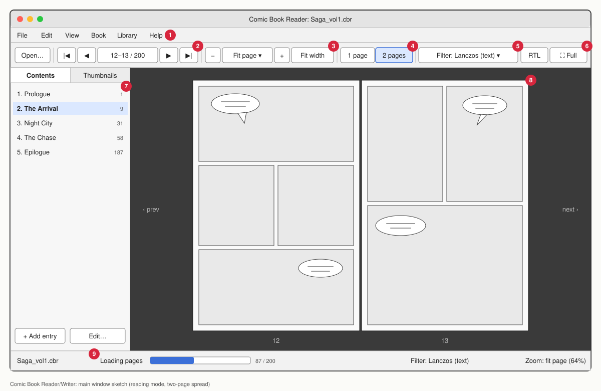

# 01 – Usage Analysis

This document is the usage analysis, it covers:

1. the **usage context** (who uses the software, on what device, in what situation);
2. the **features** users expect;
3. the **interactions** between the user and the software.

It is written from the reader's point of view, not the implementation's. Its purpose is to set the requirements for the graphical interface ([section 6](#6-resulting-ui-requirements)) and to show what the architecture must be able to support later, even if the demonstrator does not implement everything.

---

## 1. Usage context

### 1.1 Users

| Profile | Description | What matters most to them |
|---|---|---|
| **Casual reader** | Downloads or buys a few `.cbz`/`.cbr` books and reads them from start to finish. Not technical. | Opening a book with a double-click and reading right away. Simple, obvious navigation. Pages that fill the screen. |
| **Collector** | Owns hundreds of books, often scanned by themselves or by others, of uneven quality. Organises them by series, genre and publisher. | Library, tags, reading progress across many books. Image quality on poor scans. Building or fixing books (extracting pages, assembling volumes, adding a table of contents). |
| **Manga reader** | Reads Japanese comics in long series, often several volumes in a row. | Right-to-left reading. Two-page spreads that match the printed book. Moving quickly to the next volume. Sharp lettering, because text is small and dense. |

All three profiles share one need: **reading comfort**. The software is *user-centric*. Any delay (loading, decoding, resizing) must be hidden wherever possible, and the image must stay sharp, especially the lettering.

### 1.2 Devices

- **Desktop computer with a large screen**: This is the best setup for two-page spreads. Pages are only slightly downscaled (or upscaled, for low-resolution scans).
- **Laptop**: One page at a time, or a spread with heavy downscaling. Battery and memory are more limited, and the keyboard and trackpad are the main input devices.
- **Touch screen or convertible laptop**: Swipe to turn pages, pinch to zoom. Listed under *Extras*.

Consequences for the design:

- Scanned pages are usually **much larger than the display area** (e.g. 2000×3000 px shown at about 700×1050). Downscaling is the normal case, so the quality of the resize filter (low-pass filtering, anti-aliasing) is a central concern, not a detail.
- A decoded page uses a lot of memory: about **24 MB** for 2000×3000 RGBA, 10–20× its compressed JPEG size (typically 1–2 MB). Keeping a whole 200-page book in memory (about 5 GB) is not an option, so we need a cache with a memory limit and on-demand decoding.
- The window can be resized or switched to full screen at any time. Rendered pages must be recomputed for the new size without freezing the interface.

### 1.3 Situations of use

- **Long reading sessions** (30 min to several hours), often in the evening and often in full screen. Eye strain matters: dark background around the pages, no visual clutter, controls that can be hidden.
- **Hands mostly idle:** the reader keeps one hand on the keyboard (arrows / space) or the mouse (wheel / click). Turning a page must take **a single key press or click** and feel **instant**.
- **Picking up where they left off:** a book is rarely read in one sitting, and collectors read several books in parallel.
- **Occasional authoring sessions** (collector): short, task-driven sessions such as extracting a cover, merging chapters into a volume or adding a table of contents. These happen outside of reading, in separate dialogs.
- **Large and slow files:** a 200-page `.cbr` can weigh 100–300 MB and may sit on a slow disk or network share. The user must not wait for the whole archive before seeing the first page.

---

## 2. Desired features

Features are grouped into essentials, authoring, library and extras. The **Priority** column means:

- **Required**: listed in the assignment's minimum services, or part of the demonstrator it describes (Step 2).
- **Planned**: part of the full specification, and the architecture must allow it.
- **Optional**: nice to have, done if time allows.

The **Milestone** column points to the [roadmap](../../README.md#roadmap).

### 2.1 Essentials (reading)

| Feature | Description | Priority | Milestone |
|---|---|---|---|
| Open a book | Open `.cbz` (ZIP) and `.cbr` (RAR) files from a dialog, drag-and-drop or the command line. | Required | M1 / M2 |
| Image formats | Display pages stored as JPEG and BMP, then PNG. Other formats can be added later. | Required | M1 / M4 |
| Asynchronous opening | Show the first page as soon as it is decoded, while the other pages load in the background. Show loading progress. | Required | M3 |
| Navigation | Next, previous, first and last page, plus "go to page N". Keyboard, mouse and toolbar. | Required | M2 |
| Fit to screen | Scale pages automatically to the available area, and recompute when the window is resized. | Required | M2 |
| Two-page spread | Show two pages side by side. If their sizes differ slightly, scale them to the same height so they look like one spread. Single wide pages (an existing spread) are shown alone. | Required | M5 |
| Resize filters | Choose the resize filter: one suited to **text** (sharp, e.g. Lanczos / bicubic + sharpening) or one suited to **artwork** (smooth, e.g. bilinear / area averaging). Low-pass filtering when downscaling. | Required | M4 |
| Zoom | Zoom in and out, actual size. Pan with the mouse when zoomed in (assignment, Step 2 Phase D). | Required | M5 |
| Fit modes | *Fit page*, *fit width* (assignment, Step 3). | Planned | M5 |
| Prefetching | Decode and resize the next and previous pages in the background, so turning a page is instant (assignment, Step 2 Phase D). | Required | M3 |
| Full screen | Hide menus, toolbars and panels; show only the pages. | Planned | M2 / M5 |
| Text enhancement | Filters that reduce JPEG artefacts around lettering and fix scanning defects. | Planned | M4 |

### 2.2 Authoring

| Feature | Description | Priority | Milestone |
|---|---|---|---|
| Extract pages | Select one page, a range or a list of pages and save them as image files in a folder. Optionally convert them to another format. | Required | M6 |
| Assemble a book | Create a new `.cbz` from image files and/or pages taken from other books. Reorder pages by drag-and-drop before saving. | Required | M6 |
| Table of contents | Add, edit and remove entries (title → page) in an existing book. Stored as `toc.xml` inside the archive, so other readers simply ignore it. Browse the TOC from a side panel. | Required | M6 |
| Book metadata | Title, series, volume number, authors, ISBN. Read from `ComicInfo.xml` (the de facto standard used by other readers) when present. | Optional | M6 / M8 |
| Write `.cbr` | Create RAR archives. RAR compression is proprietary, so `.cbz` is the default output. | Optional | M8 |

### 2.3 Library

| Feature | Description | Priority | Milestone |
|---|---|---|---|
| Tags | Tag books by genre or style (e.g. *manga*, *western*, *sci-fi*). Required by the assignment. | Required | M7 |
| Recent books | List of recently opened books. The last page read is remembered and restored on reopening. | Planned | M7 |
| Several books in progress | Several books can be "in progress" at once, each with its own position. Switch between them from the library or the recent list. | Planned | M7 |
| Library view | Grid of covers with title, progress and tags. Filter by tag, search by title. | Planned | M7 |
| Online reference | Link a book to its page on bedetheque.com, and possibly fetch metadata from its title/ISBN. | Optional | M8 |

### 2.4 Extras

| Feature | Description | Priority | Milestone |
|---|---|---|---|
| Manga mode | Right-to-left reading: page order in spreads and arrow-key direction are reversed. | Optional | M8 |
| Continuous scrolling | Pages stacked vertically and scrolled like a web page (webtoons, long strips). | Optional | M8 |
| More archive formats | `.cb7` (7z), `.cbt` (tar). Detect the format from the file signature (magic bytes), not the extension. | Optional | M8 |
| PDF and TIFF | Read `.pdf` books (through a PDF library) and monochrome TIFF. | Optional | M8 |
| Touch gestures | Swipe to turn pages, pinch to zoom, double-tap to fit. | Optional | M8 |
| GPU resizing | Resize on the graphics card for better performance on large screens. | Optional | M8 |

---

## 3. Interactions

This section defines how the user interacts with the software: **user action → program response**. It sets the requirements for the graphical interface.

### 3.1 General principles

1. **Never block the interface.** Decoding, resizing, compression and file I/O run in background threads. The window keeps responding to input (resizing, menus, cancel) at all times.
2. **Show something right away.** When content is not ready yet, show a placeholder with a loading indicator. Never show an empty or frozen window.
3. **One action, one key.** Every reading action has a single-key shortcut, plus a mouse or toolbar equivalent.
4. **Predictable state.** The current page, display mode, zoom and filter are always visible in the toolbar or status bar.
5. **Errors don't interrupt reading.** A corrupt page shows an error placeholder and reading can continue. Errors are reported in the status bar or a non-modal notification, not a blocking dialog, except when the whole file cannot be opened.
6. **Remember user choices.** Display mode, filter and window state are kept between sessions. Reading position is kept per book.

### 3.2 Opening and closing books

| User action | Program response |
|---|---|
| *File → Open…* / `Ctrl+O` | A file dialog filtered to supported formats (`.cbz`, `.cbr`, …). |
| Drag a file onto the window, or launch with a path as argument | Opens the book directly. |
| A book is being opened | The archive index is read first. The **first page** (or the last page read) is decoded and shown as soon as it is ready. Other pages keep loading in the background, and the status bar shows *Loading pages: 87 / 200*. |
| Navigate to a page that is not loaded yet | A placeholder with a spinner is shown. That page is moved to the front of the loading queue and appears as soon as it is decoded. |
| Open a book that was read before | Opens at the last page read, with a short non-modal message: *"Resumed at page 42. Press Home to start over."* |
| Unsupported or corrupt file | Error dialog explaining the problem (*"This file is not a valid ZIP/RAR archive"*). The previous book, if any, stays open. |
| *File → Close* / `Ctrl+W` | Saves the reading position, closes the book and shows the library or an empty start screen. |
| Open a second book | The first book's position is saved. It stays in the "in progress" list. |

### 3.3 Navigation

| User action | Program response |
|---|---|
| `→` / `Page Down` / click on the **right half** of the page / ▶ button | Next page (or next spread in two-page mode). Shown instantly if prefetched. |
| `←` / `Page Up` / click on the **left half** of the page / ◀ button | Previous page or spread. |
| `Space` | Scrolls down if the page is taller than the view (zoomed in). Otherwise goes to the next page. |
| `Shift+Space` / `Backspace` | Reverse of `Space`. |
| `Home` / \|◀ button | First page. |
| `End` / ▶\| button | Last page. |
| `Ctrl+G`, or click on the page counter | "Go to page" field. Typing a number and `Enter` jumps there. |
| Mouse wheel | Scrolls inside the page when zoomed in. At the top or bottom edge, a further scroll turns the page. In *fit page* mode (nothing to scroll), each wheel step turns the page. |
| Click a TOC entry or thumbnail | Jumps to that page. |
| Reaching the last page and pressing *next* again | Non-modal message *"End of book"*. Offers to open the next volume of the series if the library knows it. |
| Manga mode on | `←` and the left click zone become *next*, `→` and the right click zone become *previous*. Spreads are laid out right to left. |

### 3.4 Display, zoom and filters

| User action | Program response |
|---|---|
| Resize the window / enter full screen | Pages are first shown immediately, scaled with a fast low-quality filter. They are then replaced by the high-quality rendering once it is ready (in the background). |
| `D` / *View → Two pages* / "2 pages" toggle | Switch between single page and two-page spread. In spread mode the two pages are scaled to the same height. |
| `+` / `Ctrl+=` / `Ctrl+wheel up` | Zoom in, keeping the point under the cursor in place. |
| `-` / `Ctrl+wheel down` | Zoom out. |
| `0` / `Ctrl+0` | Actual size (100 %). |
| `P` / *Fit page* | The whole page (or spread) fits in the view. This is the default mode. |
| `W` / *Fit width* | The page fills the width of the view and is scrolled vertically. |
| Drag with the mouse while zoomed in | Pans the page. |
| Choose a filter in the *Filter* drop-down (*Nearest*, *Bilinear*, *Bicubic*, *Lanczos (text)*, *Smooth (artwork)*, …) | The current pages are re-rendered with the new filter. The cache for the old filter is not reused. The choice is shown in the status bar and saved for this book. |
| `F` / `F11` / double-click on the page | Toggle full screen. Toolbars and panels are hidden. Moving the mouse to the top edge shows the toolbar temporarily. |
| `Esc` | Leave full screen, or close the active dialog or panel. |
| `T` | Show or hide the side panel (table of contents / thumbnails). |
| `M` / "RTL" toggle | Toggle manga (right-to-left) mode. |

### 3.5 Authoring

| User action | Program response |
|---|---|
| *Book → Extract pages…* / `Ctrl+E` | Dialog: page selection (current page, range `5-12`, list `1,3,7`, or all), destination folder and output format. A progress bar is shown while extracting, with a *Cancel* button. At the end, a message offers to open the folder. |
| *File → New book…* / `Ctrl+N` | Authoring window with a list of page thumbnails. The user adds images from disk or pages from an open book, reorders them by drag-and-drop and removes them with `Delete`. |
| *Save as `.cbz`* in the authoring window | Compression runs in the background with a progress bar. The new book can then be opened directly. |
| *Book → Table of contents → Add entry* (or "+ Add entry" in the side panel) | Adds an entry pointing to the **current page**. The user types its title inline. |
| Edit / reorder / delete a TOC entry | Changes the side panel immediately. The book is marked as modified (`*` in the title bar). |
| *File → Save* / `Ctrl+S` on a modified book | Writes `toc.xml` into the archive. The original file is replaced only after the new archive has been written successfully. A `.cbr` source is saved as `.cbz`, after a confirmation. |
| Close a modified book | Asks *Save / Discard / Cancel*. |

### 3.6 Library

| User action | Program response |
|---|---|
| *Library → Show library* / `Ctrl+L` | Library view: covers grid with title, reading progress bar and tags. Books in progress come first. |
| Double-click a cover | Opens the book at the last page read. |
| Type in the search field | Filters by title as you type. |
| Click a tag in the tag bar | Filters by that tag. Clicking several tags combines them. |
| Right-click a book → *Edit tags…* | Tag editor with autocomplete from existing tags. |
| *File → Recent books* | The last 10 books with their last page read. |
| *Library → Add folder…* | Scans a folder in the background and adds the books found. Covers are generated progressively. |

### 3.7 Keyboard shortcut summary

| Shortcut | Action | | Shortcut | Action |
|---|---|---|---|---|
| `→` `PgDn` | Next page | | `Ctrl+O` | Open book |
| `←` `PgUp` | Previous page | | `Ctrl+W` | Close book |
| `Space` / `Shift+Space`, `Backspace` | Scroll or turn page forward / backward | | `Ctrl+S` | Save (TOC changes) |
| `Home` / `End` | First / last page | | `Ctrl+N` | New book (authoring) |
| `Ctrl+G` | Go to page | | `Ctrl+E` | Extract pages |
| `+` / `-` | Zoom in / out | | `Ctrl+L` | Library |
| `0` | Actual size | | `T` | Toggle side panel (TOC / thumbnails) |
| `P` / `W` | Fit page / fit width | | `M` | Toggle manga (RTL) mode |
| `D` | Single page / two-page spread | | `Esc` | Leave full screen / close dialog |
| `F` / `F11` | Full screen | | `Ctrl+Q` | Quit |

Every shortcut is also available from a menu, so it can be discovered there, and the menu shows the shortcut next to the action.

---

## 4. Usage scenarios

### Scenario 1: Ana opens a 200-page `.cbr` and wants to start reading immediately

Ana, a casual reader, downloaded *Saga_vol1.cbr* (240 MB, 200 JPEG pages of 2000×3000 px). She double-clicks it.

1. The window opens. Within a fraction of a second the archive index is read and the window title shows the book name.
2. Page 1 is extracted and decoded first. It appears scaled to the window, with a fast filter at first and then the high-quality filter a moment later. Ana sees no difference other than the page getting slightly sharper.
3. The status bar shows *Loading pages: 12 / 200*. Ana does not have to wait for it to finish.
4. She presses `→`. Page 2 was prefetched while she was looking at page 1, so it appears instantly.
5. Curious, she presses `End`. Page 200 is not loaded yet: a placeholder with a spinner appears, page 200 jumps to the front of the queue and shows up shortly after. She presses `Home` and is back on the cover, which is still in the cache.
6. She presses `F` for full screen and `D` for two-page spreads, then reads for an hour using only `Space`.
7. She closes the window. The next day she reopens the book and it opens at page 134, where she stopped.

**What this requires:** asynchronous loading with a priority queue, prefetching of neighbouring pages, a page cache, a fast preview followed by a high-quality render, and saving the reading position.

### Scenario 2: Marc builds an anthology with a table of contents

Marc is a collector. He wants a single `.cbz` holding the three short stories scattered across three volumes, with a table of contents.

1. He presses `Ctrl+N`. The authoring window opens with an empty page list.
2. He chooses *Add pages from book…*, picks *Vol2.cbz* and selects pages 45–62 from its thumbnails. He does the same with *Vol3.cbr* (pages 1–20) and *Vol5.cbz* (pages 80–101).
3. He drags a cover image from his file manager to the top of the list and removes a blank page with `Delete`.
4. He saves as *Anthology.cbz*. A progress bar shows the compression. The window stays responsive and offers to open the new book.
5. In the reader he presses `T` to open the side panel. On page 2 he clicks *+ Add entry* and types *"Story 1: The Lighthouse"*, then does the same on pages 20 and 40.
6. `Ctrl+S` writes `toc.xml` into the archive. When he opens the book in another reader, it still works: the extra file is simply ignored.
7. In the library he tags the book *anthology* and *sci-fi*.

**What this requires:** reading pages from several archives (ZIP and RAR), writing a ZIP archive (copying the original image bytes, without re-encoding), background compression with progress, a TOC model stored as XML inside the archive, and tags.

### Scenario 3: Yuki reads a manga series on a laptop with poor-quality scans

Yuki reads a long manga series on a 13" laptop. The scans are low-quality JPEGs, and the small lettering looks blurry and full of artefacts when scaled down.

1. She presses `Ctrl+L`, filters by the tag *manga* and double-clicks the volume she is reading. It opens at page 88, where she stopped. Two other volumes of another series are also listed as in progress.
2. She presses `M` to switch to right-to-left mode. Spreads now put the earlier page on the right, and `←` moves forward.
3. The lettering is hard to read. She picks *Lanczos (text)* in the *Filter* drop-down. The current spread is re-rendered within a second and the text is noticeably sharper. The choice is remembered for this book.
4. One page is a double-page illustration (twice as wide). The reader shows it alone, across the full width, instead of squeezing it next to another page.
5. At the last page she presses `←` once more. The message *"End of book: open Volume 8?"* appears, and she accepts.

**What this requires:** a library with tags and per-book state, a manga (RTL) display mode, selectable resize filters with re-rendering, detection of wide pages, and series awareness.

---

## 5. Main window sketch

| # | Element | Purpose |
|---|---|---|
| 1 | **Menu bar** (File, Edit, View, Book, Library, Help) | Every action is available here with its shortcut, so all features can be discovered. |
| 2 | **Navigation**: first / previous / page counter / next / last | The counter shows the current page or spread and the total. Clicking it opens "go to page". |
| 3 | **Zoom & fit**: −, fit mode drop-down, +, fit width | Zoom level and fit mode. |
| 4 | **Display mode**: 1 page / 2 pages | Switch between single page and two-page spread. The active mode is highlighted. |
| 5 | **Resize filter** drop-down | Choose the filter suited to the content (text vs. artwork). |
| 6 | **RTL** (manga mode) and **Full screen** toggles | Reading direction and distraction-free mode. |
| 7 | **Side panel**: *Contents* / *Thumbnails* tabs | Browse and edit the table of contents (the current chapter is highlighted), or jump using page thumbnails. Hidden with `T`. |
| 8 | **Reading area** | Dark neutral background. Pages are centered and scaled to the same height. Clicking the left or right half turns the page. Wheel scrolls, Ctrl+wheel zooms. |
| 9 | **Status bar** | File name, **background loading progress**, active filter and effective zoom. |

In full screen, only element 8 is shown. The toolbar (2–6) slides in when the mouse touches the top edge.

---

## 6. Resulting UI requirements

This analysis leads to the following requirements for the interface and, indirectly, for the architecture (detailed in [02 – Functional Analysis](02-functional-analysis.md)):

- **UI-1**: The UI thread never decodes, resizes or compresses images. All of that is asynchronous, and results come back as signals or callbacks per page.
- **UI-2**: Page loading uses a **priority queue**: the requested page first, then its neighbours (prefetch), then the rest of the book.
- **UI-3**: Rendered pages are cached and indexed by *(page, target size, filter)*, with a memory limit and LRU eviction.
- **UI-4**: Rendering happens in two passes: an immediate fast preview, then the high-quality filter.
- **UI-5**: Display modes (single, spread, RTL, continuous) are interchangeable *layout strategies* applied to the same book model.
- **UI-6**: Resize filters are interchangeable *strategies*, listed dynamically in the filter drop-down, so a new filter shows up in the UI without changing it.
- **UI-7**: All reading actions go through a central set of commands (Qt `QAction`), shared by the menu, the toolbar and keyboard shortcuts.
- **UI-8**: Per-book state (last page, filter, display mode, tags) is saved to persistent storage and restored when the book is opened again.
- **UI-9**: Long operations (extract, assemble, save, library scan) show progress and can be cancelled.
