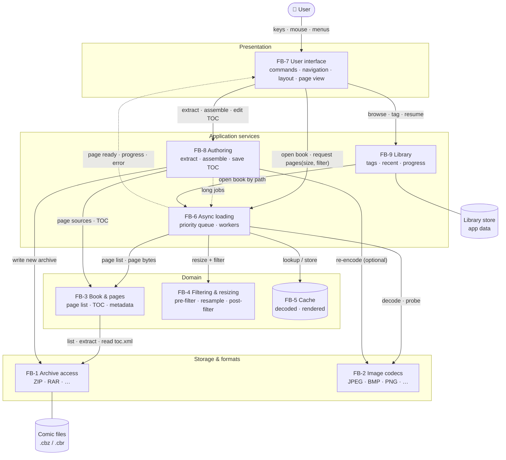
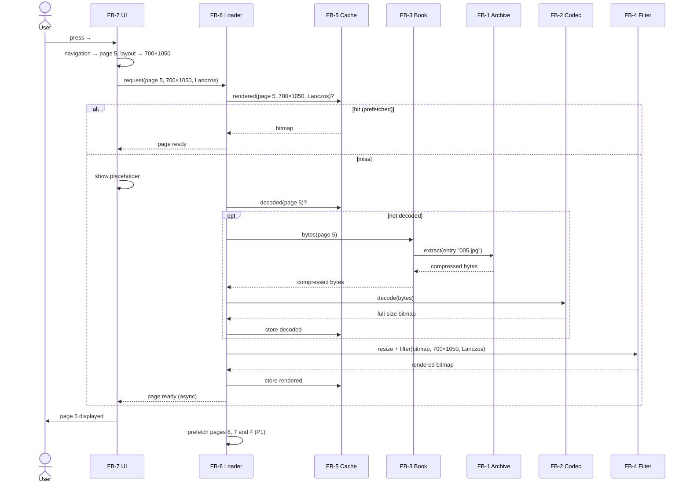

# 02 – Functional Analysis

This document is the functional analysis, it answers two questions:

1. What are the **functional blocks** of the program, and what is each one responsible for?
2. How do these blocks **interact** with each other and with their environment (files, threads, user)?

It builds on the [usage analysis](01-usage-analysis.md): every requirement listed there (UI-1 … UI-9) must be served by one of the blocks below (see [section 6](#6-traceability)). It stays at the level of *functions*. Concrete classes and their relationships are the subject of the next step: the [architecture and class diagram](03-architecture.md).

---

## 1. Overview

The program is organised in **layers**. Each layer only talks to the layer directly below it, and data flows upward:

| Layer | Blocks | Role |
|---|---|---|
| **Presentation** | 7. User interface | Shows pages, handles user input. Never decodes or resizes images itself. |
| **Application services** | 6. Asynchronous loading, 8. Authoring, 9. Library | Orchestrate work: schedule jobs in the background, build new books, remember the user's books. |
| **Domain** | 3. Book & pages, 4. Filtering & resizing, 5. Cache | The core model of a comic book and the image pipeline that produces what is displayed. |
| **Storage / formats** | 1. Archive access, 2. Image codecs | Hide the file formats (`.cbz`, `.cbr`, JPEG, PNG…) behind common interfaces. |

The two lowest layers are where most of the **extensibility** required by the assignment lives: adding a new archive format, image format or filter means adding one implementation to a block, without changing the others (see [section 5](#5-extension-points)).

---

## 2. Functional blocks

### FB-1 · Archive access

**Responsibility:** give a uniform view of a comic archive, whatever its format.

- **Detect the format from the file signature** (magic bytes), not from the extension. For example, `src/samples/fake_extension.cbr` is really a ZIP file.

  | Format | Signature |
  |---|---|
  | ZIP (`.cbz`) | `50 4B 03 04` (`PK..`) |
  | RAR 4 (`.cbr`) | `52 61 72 21 1A 07 00` (`Rar!...`) |
  | RAR 5 (`.cbr`) | `52 61 72 21 1A 07 01 00` |
  | 7z (`.cb7`, extra) | `37 7A BC AF 27 1C` |
  | tar (`.cbt`, extra) | `ustar` at offset 257 |

- **List the entries:** path, uncompressed size, whether it is a directory.
- **Extract one entry** to a memory buffer, on demand.
- **Write a new archive** from a list of (name, bytes) pairs. Only ZIP is required, because RAR compression is proprietary.

**Notes:**
- ZIP stores a central directory at the end of the file, so listing entries is instant and any entry can be extracted directly (*random access*).
- RAR has to be read header by header. In a *solid* RAR archive, extracting entry *n* requires decompressing entries 0 … *n−1* first. The loading block (FB-6) must take this into account (see [§3.4](#34-how-does-loading-interact-with-decompression)).
- The third-party libraries (e.g. libarchive, libzip, unrar) each expose a different, often C-style, API. This block wraps them behind **one common interface**, as the assignment asks.
- An open archive handle is **not thread-safe**. Reads on one archive are serialised.

**Does not:** know what a page is, decode images, or sort pages.

---

### FB-2 · Image codecs

**Responsibility:** turn the bytes of an image file into pixels, and back.

- **Identify the image format** from its signature:

  | Format | Signature |
  |---|---|
  | JPEG | `FF D8 FF` |
  | PNG | `89 50 4E 47 0D 0A 1A 0A` |
  | BMP | `42 4D` (`BM`) |
  | GIF (extra) | `GIF87a` / `GIF89a` |
  | TIFF (extra) | `49 49 2A 00` / `4D 4D 00 2A` |

- **Probe the header** to get width, height and colour depth *without decoding the whole image*. This is cheap, and it is needed early to lay out spreads and detect wide pages.
- **Decode** to a common in-memory bitmap format (8-bit RGBA, or 8-bit grey for monochrome scans).
- **Encode** a bitmap to a given format. Used only when the user converts pages while extracting or assembling a book.

**Notes:**
- One codec per format, all registered in a **codec registry** that picks the codec by signature. JPEG and BMP are implemented first, then PNG (assignment, Task 1).
- A decoded page is 10–20× larger than the compressed file (24 MB for 2000×3000 RGBA, against 1–2 MB of JPEG). Decoded bitmaps are therefore never kept "just in case": they go through the cache (FB-5), which has a memory budget.
- Codecs are stateless, so several pages can be decoded in parallel.

**Does not:** read archives, resize, or decide which page to decode.

---

### FB-3 · Book and pages (+ table of contents)

**Responsibility:** the model of a comic book. A book is an ordered list of pages plus metadata.

- **Build the page list from the archive entries:**
  - keep image entries only, ignoring things like `Thumbs.db`, `.DS_Store`, `__MACOSX/`, `info.xml`, `ComicInfo.xml` and `toc.xml` (see `src/samples/mixed.cbz`);
  - recognise images by their extension **or, when an entry has no known extension, by its signature** (first bytes): images inside archives sometimes have no extension at all (assignment, footnote 10);
  - include images in sub-folders (`src/samples/mixed.cbz`);
  - sort with a **natural sort**, so `2.jpg` comes before `10.jpg` (`src/samples/natural_sort.cbz`). Comparison is case-insensitive on the full path.
- **Page:** a *lightweight descriptor*, not the pixels. It holds:
  - its index in the book;
  - a reference to its source (an archive entry, or a file on disk when authoring);
  - its dimensions, once probed;
  - a state: *unknown → probed* / *error*. Whether the page is currently decoded is not a page state: the cache (FB-5) knows it, because decoded pixels can be evicted at any time.
- **Give access to the bytes of a page:** the book is the only block that talks to the archive in order to read pages.
- **Table of contents:** an ordered (and possibly nested) list of *(title → page)* entries. It is read from and written to a `toc.xml` file at the root of the archive. Other readers ignore that file, so the book stays compatible with them. Each entry stores both the page index and the entry file name, so it can be checked again if pages are reordered.
- **Metadata:** title, series, volume, authors, ISBN. Read from `ComicInfo.xml` (the de facto standard used by other readers) when present.

```xml
<!-- toc.xml: sketch of the format (finalised in M6) -->
<toc version="1">
  <entry title="Prologue"    page="1"  file="001.jpg"/>
  <entry title="The Arrival" page="9"  file="009.jpg"/>
  <entry title="Night City"  page="31" file="031.jpg"/>
</toc>
```

**Does not:** decode images or decide when pages are loaded.

---

### FB-4 · Filtering and resizing

**Responsibility:** produce the image that will actually be shown, from a decoded page, a **target size** and a **filter choice**.

The processing is a short pipeline, and each step can be swapped for another implementation:

1. **Pre-filter (optional):** reduce scanning and compression defects, for example JPEG deblocking or denoising, or levelling a yellowed background.
2. **Resampling** to the target size:
   - *Nearest neighbour*: fastest, used for the immediate preview (UI-4);
   - *Bilinear* / *area averaging*: smooth, suited to artwork;
   - *Bicubic*, *Lanczos*: sharp, suited to text.

   When **downscaling** (the usual case), a low-pass filter is applied first to prevent aliasing (assignment, footnote 3).
3. **Post-filter (optional):** e.g. an unsharp mask to make lettering crisper.

A **filter profile** is a named combination of these steps, for example *"Lanczos (text)"* or *"Smooth (artwork)"*. The UI lists the available profiles from a registry (UI-6).

**Notes:**
- Pure functions: the same input always gives the same output, with no shared state. They are therefore safe to run in worker threads.
- The block does not choose the target size. That is the layout's job (FB-7): for a two-page spread, the layout computes sizes so that both pages have the **same height**, and FB-4 just resizes to what it is asked.

**Does not:** cache results, read files, or know about pages or books.

---

### FB-5 · Cache

**Responsibility:** avoid computing the same image twice, within a fixed memory budget.

Two levels, because the two results cost very different amounts to produce:

| Level | Key | Content | Why |
|---|---|---|---|
| **Decoded cache** | *(book, page)* | Full-resolution bitmap | Changing the zoom or the filter doesn't need to extract and decode the page again. |
| **Rendered cache** | *(book, page, target size, filter profile)* | Bitmap ready to display | Turning back to a page that has already been shown is instant (UI-3). |

A third, optional level, the **raw bytes cache** *(book, page) → compressed bytes*, is used for solid RAR archives, where extracting an entry again is expensive.

**Rules:**
- **LRU eviction** with a **memory budget in bytes** (configurable, e.g. 512 MB in total for the decoded and rendered caches), not a number of entries, because page sizes vary a lot. The raw bytes cache has its own cap, since it must hold a whole solid archive to be useful.
- Entries currently on screen are **pinned**: they cannot be evicted while displayed.
- Changing the size or the filter just produces new keys. Old entries are not deleted explicitly; they age out under LRU.
- Closing a book removes all of its entries.
- Thread-safe: worker threads write to the cache while the UI thread reads from it.

---

### FB-6 · Asynchronous loading and prefetching

**Responsibility:** do all the slow work (extraction, decoding, resizing) **in the background**, in the order that matters most to the user (UI-1, UI-2).

- **Job types:**
  - *open book* (detect format, list entries, build the page list);
  - *probe page* (read dimensions);
  - *load page* (extract + decode);
  - *render page* (resize + filter at a given size);
  - *long tasks* for the authoring and library blocks.
- **Priority queue** with three levels:
  - **P0, visible:** the page(s) on screen, first as a fast preview, then in high quality (UI-4).
  - **P1, prefetch:** the neighbours of the current position, more ahead than behind in the reading direction (e.g. the next 2 spreads and the previous one).
  - **P2, background:** probing the rest of the book, so all page sizes are known (spread layout, wide pages) and thumbnails can be built. The progress shown in the status bar ("*Loading pages 87 / 200*") counts these.
- **Re-prioritisation:** each time the user moves, the queue is reordered around the new position. Jobs that are no longer useful are **cancelled**: each request carries a generation number, and results from an older generation are dropped.
- **Threads:**
  - one **I/O worker per open book** extracts entries in order, because archive handles are not thread-safe;
  - a **pool of CPU workers** (one per core) decodes and resizes pages in parallel;
  - the UI thread is never used for this work.
- **Notifications** sent back to the UI thread (as Qt queued signals): *book opened (page count)*, *page ready (page, size, filter)*, *progress (done, total)*, *page error (page, reason)*, *book error (path, reason)* when a book cannot be opened, *task error (task, reason)* when a long job (save, extract, scan) fails.

---

### FB-7 · User interface

**Responsibility:** everything the user sees and touches. Built with Qt 6 Widgets.

| Sub-block | Role |
|---|---|
| **Main window & commands** | Menus, toolbar, shortcuts. All actions are commands (`QAction`) shared by the menu, the toolbar and the keyboard (UI-7). |
| **Navigation controller** | Holds the current position. Turns *next / previous / first / last / go to* into a page index, taking the display mode into account (a spread moves 2 pages, wide pages are shown alone, RTL reverses the direction). |
| **Layout** | Display-mode strategies: *single*, *spread*, *spread RTL*, *continuous* (UI-5). From the current position, the view size, the zoom/fit mode and the page dimensions, it decides **which pages are shown and at what target size**. |
| **Page view** | Draws the rendered bitmaps on a dark background. While a page is not ready it shows a placeholder, or a scaled copy of an older render. Handles click zones, wheel, panning and full screen. |
| **Side panels** | Table of contents (browse, add, edit entries) and thumbnails. |
| **Status & progress** | Status bar: file name, loading progress, active filter, effective zoom. Non-modal notifications. |
| **Dialogs** | Open, go to page, extract pages, authoring window, tag editor, settings. |
| **Library view** | Covers grid, tag filter, search, books in progress. |

**Rule:** the UI holds no pixels other than what it is currently displaying, and it never calls the codecs or the archive directly. It only *asks* for pages (FB-6) and *reacts* to notifications.

---

### FB-8 · Authoring (extraction and assembly)

**Responsibility:** create new files from existing books and images.

- **Extract pages:**
  - A selection of pages (one, a range, a list or all) is written to a folder.
  - By default the **original bytes are copied unchanged** (no re-encoding, so no quality loss). With format conversion, each page is decoded (FB-2) and encoded again.
- **Assemble a book:**
  - Input: an ordered list of **page sources**. A source is either a page of an open book or an image file on disk.
  - Output: a new `.cbz` written by FB-1.
  - Entries are renamed `001.jpg`, `002.png`, … so that every reader shows them in the same order.
  - Images are stored without extra compression (JPEG/PNG are already compressed).
- **Save the table of contents:**
  - The archive is rewritten with the new `toc.xml` into a **temporary file**, which then replaces the original. If anything fails, the original is left untouched.
  - A `.cbr` source is saved as `.cbz`.
- All of these tasks run as **long jobs** in FB-6, with progress and cancellation (UI-9).

---

### FB-9 · Library

**Responsibility:** remember the user's books between sessions.

- **Persistent store**, kept in the per-user application data folder (`QStandardPaths::AppDataLocation`), e.g. an SQLite database. It holds:
  - **books**: path, *fingerprint* (size + hash of the first KB, so a moved file is recognised), title, page count;
  - **reading state**: last page, date of last reading, per-book filter and display mode (UI-8);
  - **tags**: many-to-many relation between books and tags;
  - **recent books** list.
- **Cover thumbnails** cached on disk, so the library opens fast.
- **Folder scan:** a long job (FB-6) that finds books in a folder and adds them.
- **Series** (optional, the assignment's *BookCollection*): books grouped by series and ordered by volume, from `ComicInfo.xml` or set by the user, so the reader can offer the next volume at the end of a book.
- **Online reference** (extra): link a book to its page on bedetheque.com.

---

## 3. Interactions

### 3.1 Block diagram

Solid arrows are requests, dotted arrows are notifications sent back asynchronously.



### 3.2 How does book management interact with page management?

*(Assignment 1.b.ii.1: "A book is a set of pages.")*

- The **book owns its pages**. It creates them once, when the archive is opened, by listing, filtering and naturally sorting the image entries. The page list does not change during reading.
- A **page is a descriptor, not an image**. Creating 200 pages costs almost nothing: no page is extracted or decoded when the book is opened. This is what makes asynchronous opening possible, since the page count is known immediately and the content arrives later.
- **Getting a page's content always goes through the book.** The page only knows *where* its data is (an entry name). The book holds the single archive handle and serialises access to it. The rest of the program never sees the archive.
- **Page metadata is filled in progressively.** The dimensions are set when the page is probed (FB-6, priority P2), and the state is set to *error* if decoding fails. The book is updated, but the page list stays the same.
- **The table of contents points into the page list**, by index plus file name. It belongs to the book, not to the pages, so a page can appear in several books (authoring) without carrying chapter information along.
- **When authoring, pages move between books.** A new book is built from *page sources* taken from other books or from files. When it is saved, the bytes of each source are read through its original book and written to the new archive. A page therefore never outlives the book that provides its data.

### 3.3 How does the display interact with images, filters and the cache?

*(Assignment 1.b.ii.2, and the request model of 1.c.iii: "DISPLAY asks FILTER to apply ALGORITHM to the IMAGE to be displayed and stored in the cache".)*

1. The **layout** (FB-7) works out what must be on screen: which page(s), at what target size, with which filter profile. For a spread it chooses the two target sizes so both pages have the same height.
2. The **page view** asks for each *(page, size, filter)* through FB-6. It **never decodes or resizes anything itself**.
3. FB-6 first checks the **rendered cache**. On a hit (the usual case thanks to prefetching), the bitmap is returned immediately and the page is drawn in the same frame.
4. On a miss, FB-6 checks the **decoded cache**. If the full-resolution bitmap is there (for example when only the zoom or filter changed), only the resize is needed. Otherwise the page is first extracted (FB-3 → FB-1) and decoded (FB-2).
5. **FB-4 resizes and filters** the bitmap. The result is stored in the rendered cache and FB-6 notifies the page view, which redraws.
6. While waiting, the page view shows the **fast preview**: a quick nearest-neighbour render scheduled at P0 before the high-quality one, or a scaled copy of whatever older render is available.
7. **Changing the filter** changes the cache key, so the visible pages are requested again and old renders age out. **Resizing the window** works the same way. Requests are debounced (about 150 ms) during a live resize, and the current bitmaps are stretched in the meantime.

### 3.4 How does loading interact with decompression?

*(Assignment 1.b.ii.3.)*

**Opening a book:**

1. The UI asks FB-6 to open a path. The *open book* job runs on the book's I/O worker.
2. FB-1 reads the **file signature** and chooses the matching archive reader from its registry.
3. The reader **lists the entries**. For ZIP this means reading the central directory at the end of the file, which is fast. For RAR the headers are read one after the other.
4. FB-3 builds the page list and FB-6 sends *book opened (page count)*. The UI immediately requests the first page, or the last page read (FB-9). If any of steps 2–4 fails (unknown format, unreadable file), FB-6 sends *book error (path, reason)* instead, and the book being read, if any, stays open.
5. The first page goes through the pipeline at P0. Meanwhile the P1 (neighbours) and P2 (probe everything) jobs are queued. The user can **read before the rest of the book is loaded**.

**Reading pages from the archive:**

- **Random-access archives (ZIP, non-solid RAR):** each *load page* job extracts only its own entry. Jumping to page 200 costs one extraction.
- **Solid archives (solid RAR, 7z):** reaching entry *n* means decompressing everything before it. The I/O worker therefore **streams the archive once, in order**, and keeps each entry's compressed bytes in the raw bytes cache, which costs about the file size. Later requests are served from memory. A jump to the end shows a placeholder until the stream gets there.
- Extraction is **serialised per archive** (one I/O worker), while decoding and resizing run **in parallel** on the CPU pool. The I/O worker hands raw bytes to the CPU workers, so a slow disk and a slow CPU never block each other.

**Writing (authoring, saving a TOC):**

- FB-8 collects the bytes of each page source (through FB-3), optionally re-encodes them (FB-2), and FB-1 writes the new ZIP to a temporary file, which is then moved into place.
- The job runs in the background with progress and cancellation. The book being read stays open and usable. If the job fails, FB-6 sends *task error (task, reason)* and the original file is left untouched.

---

## 4. Flow: "turn the page"

The most frequent interaction, which must feel instant. In single-page mode the user is on page 4 and presses `→`:

```
UI requests page 5 → in rendered cache? → yes: display
                                        → no: in decoded cache? → no: Book → Archive extracts → ImageCodec decodes
                                                                → Filter resizes → stored in cache → UI displays
```

Step by step:

1. **Input:** the user presses `→`. The command *next page* fires.
2. **Navigation:** the navigation controller computes the new position, page 5 (in spread mode: the next spread, honouring wide pages and RTL).
3. **Layout:** the layout computes the target size of page 5 from the view size and the fit mode, e.g. 700×1050 in *fit page*.
4. **Request:** the page view asks FB-6 for *(page 5, 700×1050, "Lanczos (text)")*. FB-6 bumps the generation number and **re-prioritises**: page 5 at P0, pages 6–7 and 4 at P1, the rest unchanged.
5. **Rendered cache?** Page 5 was prefetched while the user read page 4, so it is a **hit**. The bitmap is drawn right away and the flow ends here. *This is the normal case.*
6. **Miss → decoded cache?** If the user jumped instead (e.g. `End`), the page view first shows a placeholder. If the full-resolution bitmap is cached, go straight to step 9.
7. **Book → Archive extracts:** the job asks FB-3 for the bytes of page 5. FB-3 asks FB-1 to extract the entry, on the book's I/O worker.
8. **ImageCodec decodes:** a CPU worker picks the codec by signature and decodes to RGBA. The result goes into the decoded cache.
9. **Filter resizes:** the same worker applies the filter profile (low-pass + Lanczos + sharpening) at 700×1050.
10. **Stored in cache:** the result goes into the rendered cache and is pinned while it is on screen.
11. **UI displays:** FB-6 sends *page ready* to the UI thread. If the request is still current (same generation), the page view draws it. Otherwise the result is just kept in the cache.
12. **Prefetch:** the P1 jobs (pages 6, 7 and 4) run in turn, so the *next* `→` is a cache hit again. The last page read is saved (FB-9).



---

## 5. Extension points

The assignment asks that new formats and algorithms be added **by derivation, without changing existing code**. Each extension point is an abstract interface with a registry:

| To add… | Block | Implement | Registered in | Untouched |
|---|---|---|---|---|
| An archive format (`.cb7`, `.cbt`) | FB-1 | an archive reader (and optionally a writer) + its signature | archive registry | Book, loader, UI |
| An image format (PNG, GIF, TIFF, WebP) | FB-2 | a codec (probe, decode, encode) + its signature | codec registry | Archive, filters, UI |
| A resize or enhancement filter | FB-4 | a resampler or a pre-/post-filter, combined into a profile | filter registry (listed in the UI automatically) | Cache, loader, UI code |
| A display mode (continuous, RTL) | FB-7 | a layout strategy | layout list in the *View* menu | Book, rendering pipeline |
| A document type (PDF) | FB-1 + FB-2 | a "book source" that produces page bytes (rendered PDF pages) | archive registry | Everything above FB-3 |

---

## 6. Traceability

How the requirements from the usage analysis are covered:

| Requirement ([01](01-usage-analysis.md#6-resulting-ui-requirements)) | Covered by |
|---|---|
| UI-1: no image work on the UI thread | FB-6 (workers), FB-7 rule |
| UI-2: priority queue, prefetch | FB-6 (P0 / P1 / P2, re-prioritisation) |
| UI-3: cache indexed by page, size, filter, with memory limit | FB-5 (rendered cache, LRU, byte budget) |
| UI-4: fast preview then high quality | FB-6 (two P0 jobs), FB-4 (nearest vs. profiles) |
| UI-5: interchangeable display modes | FB-7 (layout strategies) |
| UI-6: filters listed dynamically | FB-4 (filter registry) |
| UI-7: shared commands | FB-7 (main window & commands) |
| UI-8: per-book state persisted | FB-9 (reading state) |
| UI-9: long operations with progress and cancel | FB-6 (long jobs), FB-8, FB-9 (scan) |

And the assignment's minimum services:

| Minimum service | Blocks |
|---|---|
| Asynchronous opening, read the first pages before loading ends | FB-6, FB-3, FB-1 |
| Resize images to the screen | FB-7 (layout), FB-4 |
| Several pages on screen, matched sizes | FB-7 (spread layout), FB-2 (probe) |
| Selectable resize filter (text vs. graphics) | FB-4, FB-7 |
| Next / previous / first / last page | FB-7 (navigation) |
| Extract pages | FB-8 |
| Create a book by assembling pages | FB-8, FB-1 (writer) |
| Add a table of contents | FB-3 (TOC), FB-8 (save) |
| Tags | FB-9 |
