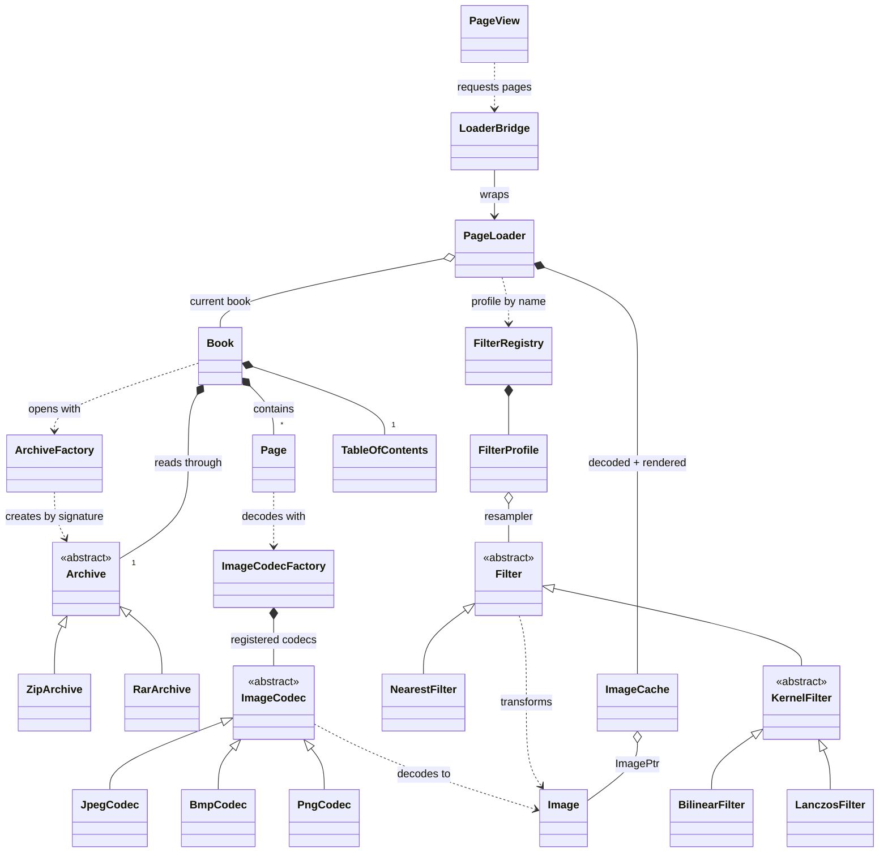
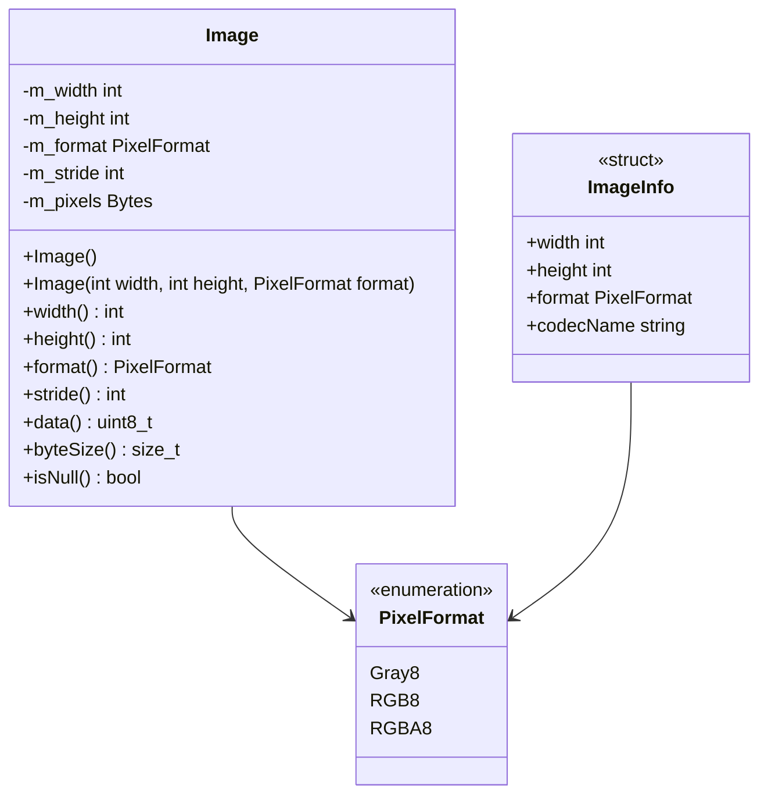
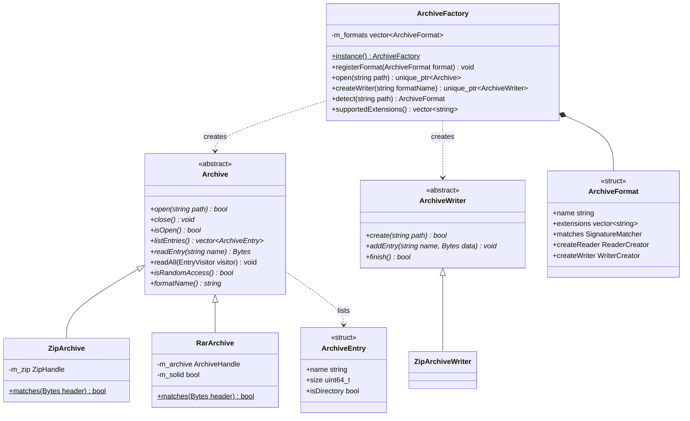
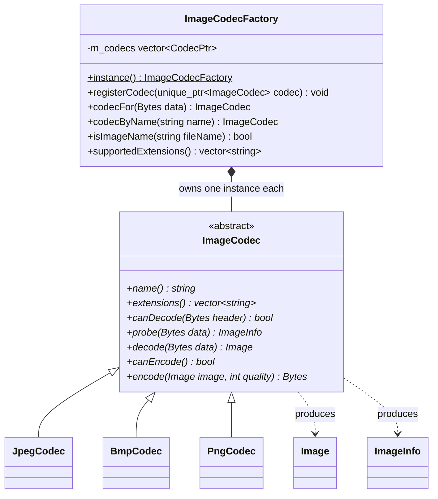
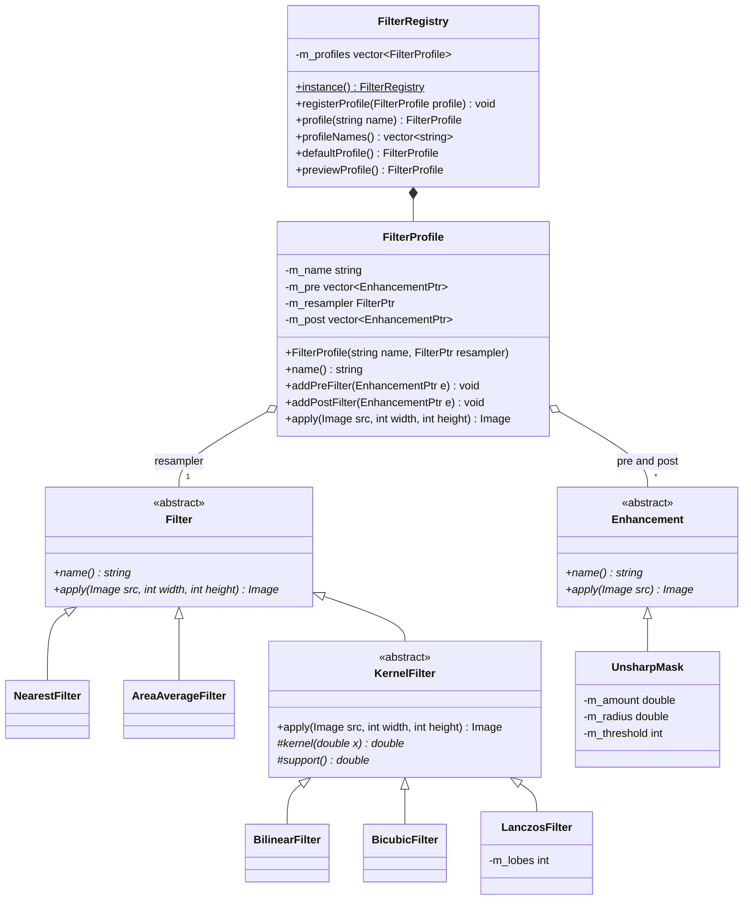
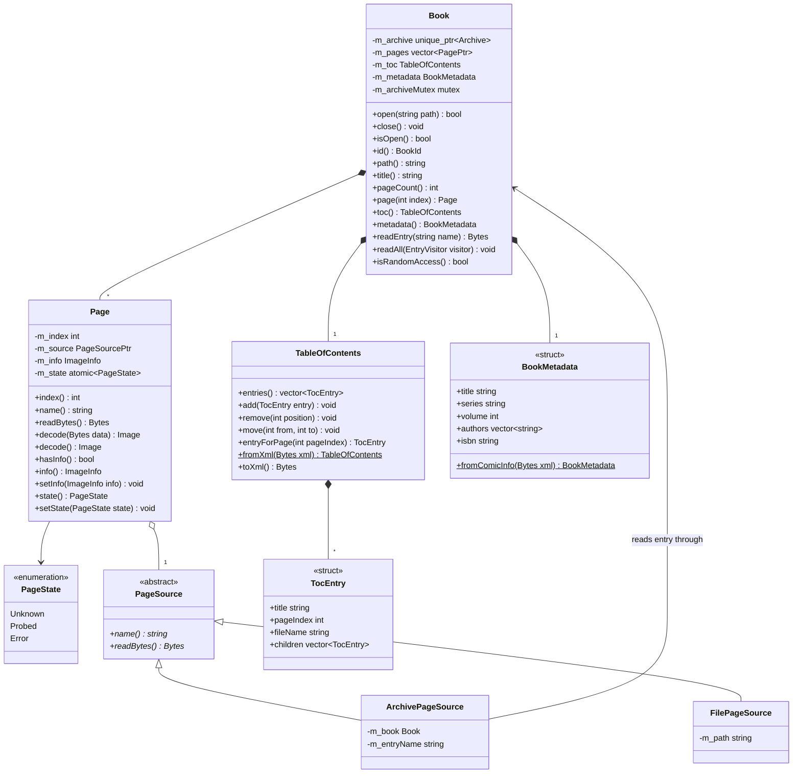
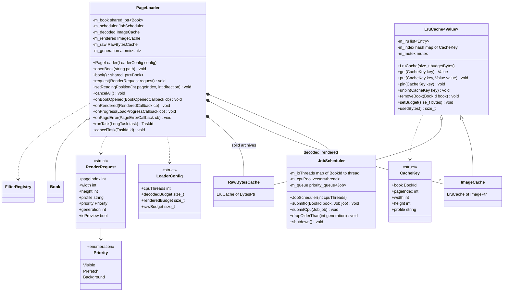
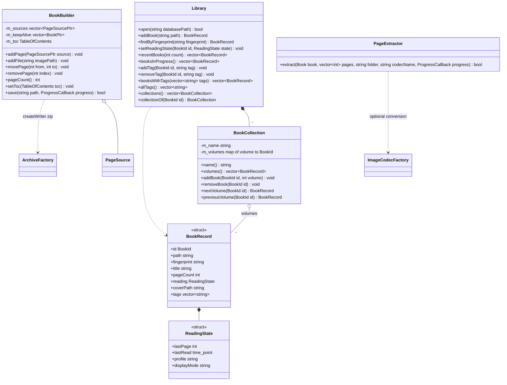
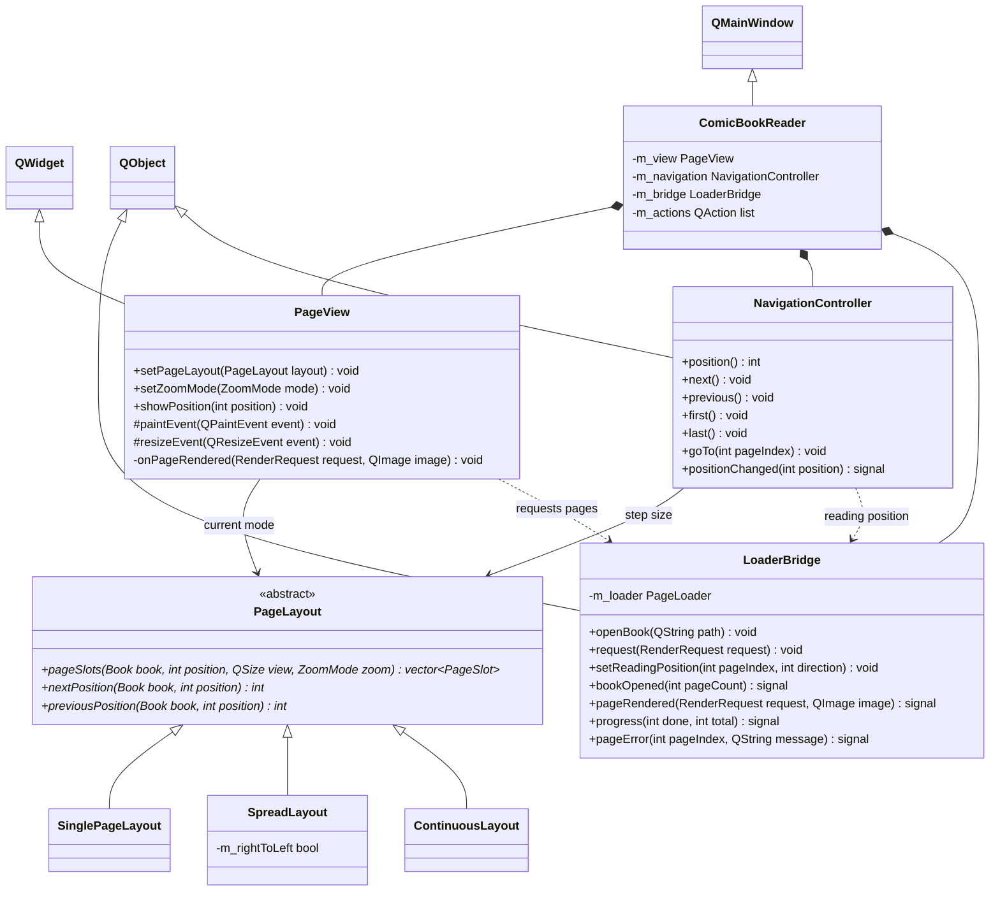
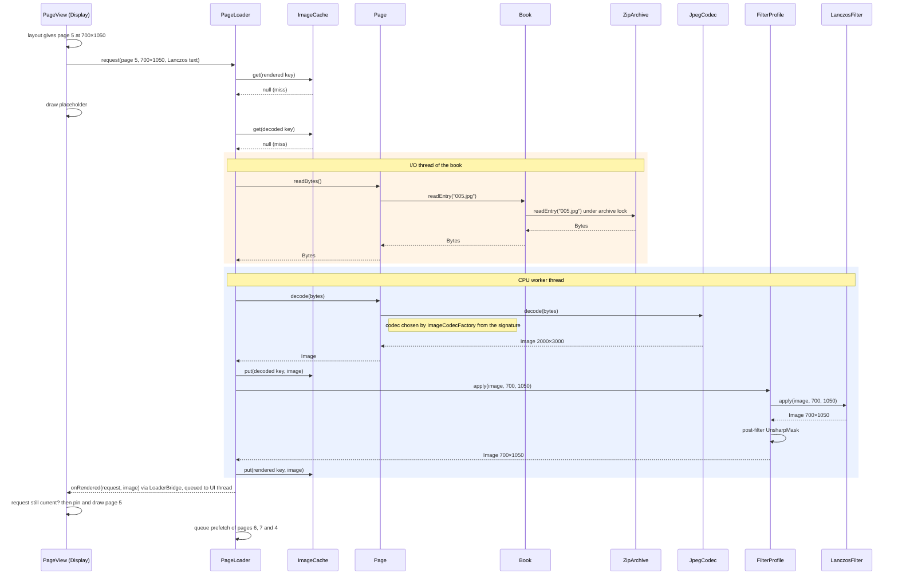

# 03 – Architecture (class diagram)

This document is the coarse-grained architecture:

1. the **main classes** of the program, and why each one exists;
2. how the design achieves **modularity and extensibility**: a new archive format, image format or filter is added *by deriving a class*, without changing existing code;
3. the **interactions** between these classes, following the assignment's request model: *DISPLAY asks FILTER to apply ALGORITHM to the IMAGE, to be displayed and stored in the cache*.

It turns the functional blocks of the [functional analysis](02-functional-analysis.md) (FB-1 … FB-9) into classes. The next step (issue #8) turns this diagram into C++ headers.

> **Status:** proposal to be discussed and agreed on by the whole team. It defines the contract between `comic_core` and the UI. Open questions are listed in [section 9](#9-open-questions-for-the-team).

---

## 1. Design principles

| # | Principle | Consequence |
|---|---|---|
| P1 | **The core does not depend on Qt.** | `comic_core` builds with `-DBUILD_UI=OFF` (already supported by `CMakeLists.txt`). Core code can be unit-tested without a GUI. The core uses its own `Image` class, and only the UI converts it to `QImage`. |
| P2 | **Program against abstractions.** | Every variable part (archive format, image format, resize algorithm, display mode) is an **abstract class** with one subclass per variant (*Strategy* pattern). |
| P3 | **New variants are found through registries.** | `ArchiveFactory`, `ImageCodecFactory` and `FilterRegistry` pick the right implementation at run time, from a file signature or a name. Callers never write `new ZipArchive` or test `if (ext == "cbz")`. Adding a variant = writing the subclass + **one registration line**. |
| P4 | **Stateless where possible.** | Codecs and filters keep no state between calls. One shared instance serves every thread, with no locking. Archives are stateful (an open file), so each book gets its own instance. |
| P5 | **One owner for asynchrony.** | Only `PageLoader` starts threads. `Book`, `Page`, codecs and filters are plain synchronous classes, easy to test, which the loader calls from its workers. |
| P6 | **Shared, immutable images.** | A finished image is handed around as `ImagePtr = std::shared_ptr<const Image>`. The cache, the loader and the UI can hold the same image without copying it, and without one thread modifying it under another. |
| P7 | **Explicit errors.** | `open()` returns `false` when a file cannot be opened. Unexpected failures (corrupt entry, undecodable image) throw an exception derived from `ComicError`. `PageLoader` catches it and reports a *page error*, so one bad page never stops reading. |

Type aliases used below: `Bytes = std::vector<uint8_t>`, `ImagePtr = std::shared_ptr<const Image>`.

---

## 2. Diagram notation

| Mermaid | Meaning |
|---|---|
| `A <\|-- B` | B **inherits** from A |
| `A *-- B` | A **owns** B (composition: B dies with A) |
| `A o-- B` | A **holds** B, which can be shared (aggregation) |
| `A --> B` | A **uses** B permanently (association) |
| `A ..> B` | A **depends** on B for a call, or creates it (dependency) |
| `<<abstract>>` | abstract class: at least one pure virtual method |
| `method()*` | pure virtual method |
| `method()$` | static method |

Pointer and reference qualifiers (`*`, `&`, `const`) are left out of the diagrams, because a trailing `*` is Mermaid's marker for an abstract method. For example, `codecFor()` actually returns `const ImageCodec*` (null if no codec matches). Exact signatures are fixed in the headers (#8).

---

## 3. Overview

The main classes and how they relate. Members are left out here; they are detailed per package in [section 4](#4-classes-in-detail).



How the classes map to the functional blocks of [02](02-functional-analysis.md#2-functional-blocks):

| Block | Classes |
|---|---|
| FB-1 Archive access | `Archive`, `ArchiveEntry`, `ZipArchive`, `RarArchive`, `ArchiveWriter`, `ZipArchiveWriter`, `ArchiveFactory` |
| FB-2 Image codecs | `Image`, `ImageInfo`, `ImageCodec`, `JpegCodec`, `BmpCodec`, `PngCodec`, `ImageCodecFactory` |
| FB-3 Book & pages | `Book`, `Page`, `PageSource`, `TableOfContents`, `TocEntry`, `BookMetadata` |
| FB-4 Filtering & resizing | `Filter`, `NearestFilter`, `KernelFilter` (+ subclasses), `AreaAverageFilter`, `Enhancement`, `UnsharpMask`, `FilterProfile`, `FilterRegistry` |
| FB-5 Cache | `LruCache`, `ImageCache`, `RawBytesCache`, `CacheKey` |
| FB-6 Async loading | `PageLoader`, `RenderRequest`, `JobScheduler` |
| FB-7 User interface | `ComicBookReader`, `PageView`, `NavigationController`, `PageLayout` (+ subclasses), `LoaderBridge` |
| FB-8 Authoring | `BookBuilder`, `PageExtractor` |
| FB-9 Library | `Library`, `BookRecord`, `ReadingState`, `BookCollection` |

---

## 4. Classes in detail

### 4.1 Image



| Class | Why it exists |
|---|---|
| `Image` | The only pixel container in the core: a plain buffer of decoded pixels. **Why not `QImage`?** The core must build and be tested without Qt (P1), and the filters need direct, predictable access to the pixel memory. The UI wraps an `Image` in a `QImage` **without copying** (a `QImage` constructor takes an external buffer plus a cleanup function that keeps the `ImagePtr` alive). `byteSize()` lets the cache count its memory budget. |
| `PixelFormat` | Scans of manga and black-and-white comics are often greyscale. Keeping them as `Gray8` uses **4× less memory** than RGBA and makes filtering 3–4× faster. Filters must support all three formats. |
| `ImageInfo` | The result of *probing* an image: size and format, read from the header without decoding the pixels. It is needed early (the `Background` probe pass of `PageLoader`) to lay out two-page spreads and detect wide pages, before any page is decoded. |

---

### 4.2 Archives



`SignatureMatcher = bool (*)(const Bytes& header)`, `ReaderCreator = std::function<std::unique_ptr<Archive>()>`, `WriterCreator = std::function<std::unique_ptr<ArchiveWriter>()>` (may be empty), `EntryVisitor = std::function<bool(const ArchiveEntry&, const Bytes&)>` (returns `false` to stop).

| Class | Why it exists |
|---|---|
| `Archive` | The **common object model** for comic archives, as the assignment requires: whatever the library behind it (often a C API), the rest of the program only sees *list the entries*, *read one entry* and *read them all in order*. `isRandomAccess()` tells the loader whether reading entry *n* is cheap (ZIP) or requires decompressing everything before it (solid RAR, 7z), so it can choose a strategy ([02 §3.4](02-functional-analysis.md#34-how-does-loading-interact-with-decompression)). For non-random-access archives the loader uses `readAll()`, which goes through the archive **once, in order**. Calling `readEntry()` for each page of a solid archive would decompress from the start every time, which is O(n²). `readAll()` is virtual but not abstract: the default implementation simply calls `readEntry()` for each entry, so random-access formats don't need to override it. |
| `ArchiveEntry` | What [02 FB-1](02-functional-analysis.md#fb-1--archive-access) asks the listing to return: name, uncompressed size and whether it is a directory. Formats don't mark directories the same way (a ZIP uses a trailing `/`, RAR uses a flag), so `Book` must not guess from the name. The size lets the loader allocate buffers and estimate memory use. |
| `ZipArchive` | `.cbz` support. Wraps the ZIP library (an *Adapter*). Random access via the central directory. |
| `RarArchive` | `.cbr` support. Wraps the RAR reading library. Detects solid archives and overrides `readAll()` with a single streaming pass. |
| `ArchiveWriter` | Writing is a **separate interface** from reading, because not every format can be written: RAR compression is proprietary. A reader class is never forced to implement a `write` it cannot honour (*Interface Segregation*). Used by authoring and by "save table of contents". |
| `ZipArchiveWriter` | Writes `.cbz` files, the output format for new books. |
| `ArchiveFormat` | Everything the program needs to know about one format, in one record: its name, extensions (for the open dialog filter), signature test and how to create a reader and a writer. |
| `ArchiveFactory` | **Chooses the format from the file signature**, not the extension (`src/samples/fake_extension.cbr` is a ZIP). It tries each registered `matches()` on the first bytes of the file and creates the matching reader. Nothing outside it knows the concrete archive classes. `supportedExtensions()` feeds the open dialog, so a new format shows up there automatically. |

`matches()` is **static**: the format can be detected before any instance is created.

---

### 4.3 Image codecs



| Class | Why it exists |
|---|---|
| `ImageCodec` | The "abstract class encapsulating every function the program needs to handle images" asked for in Task 1 of the assignment: recognise, probe, decode and encode one format. Codecs are **stateless** (P4): one instance per format, shared by all worker threads. |
| `JpegCodec`, `BmpCodec` | The two formats of the first demonstrator (assignment, Step 2 a). JPEG decoding should support decoding straight to `Gray8` for greyscale scans. |
| `PngCodec` | The first format added *afterwards* (assignment, Step 2). It is the proof that the design works: adding it must not change any other class ([section 7.2](#72-adding-an-image-format-png)). |
| `ImageCodecFactory` | Picks the codec from the **content** (`codecFor` checks each `canDecode()` against the signature). This handles misnamed files. `isImageName()` checks the extension only: it is used by `Book` to decide which archive entries are pages *without extracting them*, which keeps opening a book fast. Entries with no known extension are the exception: `Book` reads them and asks `codecFor()`, so extension-less images (assignment, footnote 10) are not lost. `codecByName()` is used when the user chooses an output format (extraction with conversion). |

---

### 4.4 Filters



| Class | Why it exists |
|---|---|
| `Filter` | A **resize algorithm** (the "ALGORITHM" of the assignment's request model). One signature for all of them: source image + target size → new image. Stateless, so safe on any thread. |
| `NearestFilter` | The fastest algorithm, with no smoothing. Used for the **immediate preview** (UI-4) and for pixel art. |
| `AreaAverageFilter` | Averages every source pixel covered by a target pixel: a simple, correct **low-pass filter for downscaling** (the averaging filter suggested in footnote 3 of the assignment). Smooth, good for artwork. |
| `KernelFilter` | Bilinear, bicubic and Lanczos differ **only by their kernel function** and its width. This class implements the separable two-pass convolution once (*Template Method*). It also widens the kernel by the downscale factor, which gives the anti-aliasing low-pass filter for free. A new kernel-based filter is about 10 lines: `kernel()` and `support()`. |
| `BilinearFilter`, `BicubicFilter`, `LanczosFilter` | From smoothest to sharpest. Lanczos keeps lettering crisp (*text* profile). Bilinear/bicubic are better for artwork and noisy scans. |
| `Enhancement` | A filter that **keeps the size**: sharpening, JPEG deblocking, levels. It is a separate interface from `Filter`, so a "resize" filter never has to ignore its width and height arguments. |
| `UnsharpMask` | Sharpens edges after downscaling. This reduces the blurred, haloed look of JPEG lettering (assignment, "filters to enhance the text"). |
| `FilterProfile` | What the user actually picks in the *Filter* drop-down: a **named pipeline** of pre-filters → one resampler → post-filters (e.g. *"Lanczos (text)"* = Lanczos-3 + light unsharp mask). The UI and the cache only deal with profile names, and the profile itself is used as a `Filter` (same `apply` signature). |
| `FilterRegistry` | Lists the profiles so the UI can **fill the drop-down dynamically** (UI-6). It also provides the default profile and the fast preview profile. |

`FilterPtr = std::shared_ptr<const Filter>`, `EnhancementPtr = std::shared_ptr<const Enhancement>`. They are shared because several profiles can reuse the same algorithm instance.

---

### 4.5 Book model



| Class | Why it exists |
|---|---|
| `Book` | The assignment's **BOOK**: an ordered set of pages plus a table of contents and metadata. `open()` asks `ArchiveFactory` for the right reader, then builds the page list: it skips system files (`Thumbs.db`, `__MACOSX/`, …), keeps image entries (by extension with `ImageCodecFactory::isImageName`, or by signature with `codecFor()` for entries with no known extension, since images inside archives sometimes have none: assignment, footnote 10), sorts them **naturally** (`2.jpg` before `10.jpg`), and reads `toc.xml` / `ComicInfo.xml` if present. It is the **only owner of the archive handle**: `readEntry()` and `readAll()` lock a mutex, because archive libraries are not thread-safe. Opening does **not** decode anything, which is what makes asynchronous opening possible. `Book` itself is synchronous (P5); `PageLoader` calls `open()` on a worker thread. |
| `Page` | The assignment's **PAGE**: a lightweight descriptor (*Proxy* / lazy loading). It knows *where* its bytes are, but holds no pixels. Loading is split in two halves, matching the threads of [02 §3.4](02-functional-analysis.md#34-how-does-loading-interact-with-decompression): `readBytes()` (I/O, runs on the book's I/O thread) and `decode(bytes)` (CPU, runs on the pool, with the codec chosen by `ImageCodecFactory`). `decode()` without arguments just chains the two: it is the simple sequential version for tests and for the first demonstrator (assignment, Step 2 Phase A). The result is **not stored in the page**: it goes into `ImageCache`, which has the memory budget. `info` and `state` are filled in progressively by the background probe, so they are thread-safe. Pages are held by pointer (`PagePtr`) so their address never changes. |
| `PageState` | Lets the UI show a placeholder or an error page, and the loader skip pages known to be corrupt. "Decoded" is **not a page state** ([02 FB-3](02-functional-analysis.md#fb-3--book-and-pages--table-of-contents)): the cache can evict the pixels at any time, so the page would hold a stale state. Whether a page is decoded is answered by `ImageCache::get()`. |
| `PageSource` | Where a page's bytes come from. A page usually comes from an archive entry, but in **authoring** a new book mixes pages from other books with image files from disk. This abstraction lets `BookBuilder` and `PageExtractor` treat them all the same. (PDF support, as planned in [02 §5](02-functional-analysis.md#5-extension-points), plugs in one level lower, as an `Archive` whose entries are rendered pages.) |
| `ArchivePageSource`, `FilePageSource` | The two sources needed now. `ArchivePageSource` goes through `Book::readEntry()`, so the archive lock is respected. It holds a non-owning reference to its book: whoever uses pages of another book (e.g. `BookBuilder`) keeps that book alive with a `shared_ptr`. |
| `TableOfContents`, `TocEntry` | The table of contents, as an extension of the format: a `toc.xml` file at the root of the archive, which other readers ignore. Entries are nested (chapters → sections). Each stores the page index **and** the entry file name, so it can be checked again if pages are reordered. Serialisation sits next to the model (`fromXml` / `toXml`). |
| `BookMetadata` | Title, series, volume, authors, ISBN. Read from `ComicInfo.xml`, the de facto standard used by other readers, when present. It is also the key for a future bedetheque.com lookup. |

---

### 4.6 Asynchronous loading and cache



| Class | Why it exists |
|---|---|
| `PageLoader` | The **single entry point for asynchronous work** (P5): the UI asks it to open a book or render a page, and gets the results through callbacks. Internally it checks the caches, then runs `Page::readBytes()` on the book's I/O thread and `Page::decode(bytes)` followed by `FilterProfile::apply()` on the CPU pool. For a book whose archive is not random-access, it streams the archive once with `Book::readAll()` into the raw bytes cache. For a `Visible` request that misses the cache, it first renders a **fast preview** with `FilterRegistry::previewProfile()` and then the requested profile. Both results arrive through `onRendered`, the first one marked `isPreview` (UI-4). It also handles **prefetching**: `setReadingPosition()` queues the neighbouring pages at `Prefetch` priority, more ahead than behind in the reading direction. `openBook()` also queues the background probe of every page (`Background`), and `onProgress` reports it ("Loading pages 87 / 200"). `runTask()` runs the long operations of authoring and library (save, extract, folder scan) on the same scheduler, so P5 holds: nothing else starts threads. It is **independent of Qt**: callbacks are plain `std::function`s, run on worker threads. |
| `RenderRequest` | One request from the display: *this page, at this size, with this profile*. The `generation` number lets the loader drop results that arrive after the user has moved on. `isPreview` is set on the result of the fast preview pass, so the view knows a better image is on its way. |
| `LoaderConfig` | Thread count, the decoded and rendered budgets (the 512 MB total of [02 FB-5](02-functional-analysis.md#fb-5--cache) split between them) and the maximum size of the raw bytes cache. Set from the user's settings. |
| `Priority` | The three queue levels from [02 FB-6](02-functional-analysis.md#fb-6--asynchronous-loading-and-prefetching): what is on screen first, then the neighbours, then the rest of the book. |
| `JobScheduler` | The threads: **one I/O thread per open book** (reads on one archive are serialised anyway, but two books, e.g. while assembling, can be read in parallel) and **a pool of CPU threads** (decoding and filtering run in parallel), fed by a priority queue. It is kept apart from `PageLoader` so the queueing logic can be tested without threads, and so authoring and library jobs (FB-8, FB-9) can share the same pool. |
| `LruCache` | The shared implementation: LRU eviction under a **budget in bytes**, pinning, removal of a whole book, locking. Written once as a template and used for both kinds of value. |
| `ImageCache` | `LruCache` of images (each `Image` reports its `byteSize()`). It is used twice: one instance for **decoded** pages (key with `width = height = 0` and no profile) and one for **rendered** pages, each with its own budget. Values are `ImagePtr`, so evicting an entry never frees an image the UI is still drawing. `pin()` keeps the visible pages from being evicted. It is thread-safe. |
| `RawBytesCache` | The third, optional level of [02 FB-5](02-functional-analysis.md#fb-5--cache): the **compressed bytes** of each entry of a solid archive, filled by the single `readAll()` pass, so a page can be decoded again without decompressing the archive from the start. Costs about the file size, much less than decoded pages. Its budget must therefore hold the **whole** archive (`rawBudget` is a cap, e.g. 1 GB). If it is smaller, evicted entries force the archive to be streamed again from the start. |
| `CacheKey` | *(book, page, size, profile)*: changing the window size or the filter gives a new key, so stale images are never shown (UI-3). |

---

### 4.7 Authoring and library



| Class | Why it exists |
|---|---|
| `BookBuilder` | **Assembles a new book** (assignment: "create a book by assembling pages"): an ordered list of `PageSource`s, edited by the authoring window, then written by a `ZipArchiveWriter` as `001.jpg`, `002.png`… so every reader keeps the order. Original bytes are copied unchanged, with no re-encoding and so no quality loss. It also rewrites an existing book to **save a new `toc.xml`** (write to a temporary file, then replace the original). |
| `PageExtractor` | **Extracts pages** to a folder. Raw copy by default, or decode + encode with the chosen codec when the user converts. |
| `Library` | Persistent store (SQLite) of the user's books: reading state, tags, recent books, books in progress (FB-9). Books are identified by a **fingerprint** (size + hash of the first KB) as well as their path, so a moved file keeps its tags and position. |
| `BookRecord` | One row of the library, a plain value passed to the UI. `coverPath` points to the cover thumbnail cached on disk. |
| `BookCollection` | The **BookCollection** suggested by the assignment (p. 5): the books of one series, ordered by volume. Filled from `ComicInfo.xml` (series + volume) when present, or by the user. It powers *"End of book: open Volume 8?"* ([01](01-usage-analysis.md), Scenario 3) and grouping by series in the library view. It holds library records, not open `Book`s: opening a book stays the loader's job. `nextVolume()` returns an empty record when there is none. |
| `ReadingState` | What is restored when a book is reopened (UI-8): last page, date of last reading (for sorting *recent* and *in progress*), filter profile and display mode. |

Long operations (`save`, `extract`, folder scan) are started with `PageLoader::runTask()`, which runs them on the `JobScheduler`. They report progress through a `ProgressCallback = std::function<bool(int done, int total)>`: returning `false`, or calling `cancelTask()`, cancels the operation (UI-9). `BookBuilder::save()` only replaces the original file once the new archive is complete, so a cancelled save leaves it untouched.

---

### 4.8 User interface (Qt)



| Class | Why it exists |
|---|---|
| `ComicBookReader` | The main window (already in `src/ui/`). It owns the actions (`QAction`) shared by the menus, the toolbar and the keyboard shortcuts (UI-7), and wires the other UI objects together. |
| `PageView` | The **DISPLAY** of the assignment. It asks the current `PageLayout` which pages go where and at what size, sends a `RenderRequest` for each, and draws whatever is ready: the final image, the fast preview, or a placeholder. It never decodes or filters anything (UI-1). |
| `NavigationController` | Holds the reading position and implements next / previous / first / last / go to. The step depends on the layout (one page, a spread, a wide page alone, RTL), so it delegates the step to the `PageLayout`. Each move is passed on to `LoaderBridge::setReadingPosition()`, so the loader re-prioritises and prefetches around the new position. |
| `PageLayout` | Display modes as interchangeable strategies (UI-5). Named `PageLayout`, not `Layout`, so it is never confused with Qt's `QLayout` (and `setPageLayout()` does not hide `QWidget::setLayout()`). From the position, the view size and the zoom mode it returns *page slots* (page index + rectangle + target size). This is where the two pages of a spread are given **the same height**. |
| `SinglePageLayout`, `SpreadLayout`, `ContinuousLayout` | One page, two pages (with a right-to-left option for manga, and wide pages shown alone), vertical scrolling (extra). |
| `LoaderBridge` | Adapts the Qt-free `PageLoader` to Qt (*Adapter*). Loader callbacks arrive on worker threads. The bridge re-emits them as **queued signals**, which Qt delivers on the UI thread, and converts `ImagePtr` to `QImage` without copying the pixels. |

---

## 5. Interaction: "display a page"

This follows the assignment's request model, *DISPLAY asks FILTER to apply ALGORITHM to the IMAGE, to be displayed and stored in the cache*. Mapped onto our classes:

| Assignment | Class |
|---|---|
| DISPLAY | `PageView` (through `LoaderBridge` → `PageLoader`, which carries the request to a worker thread) |
| FILTER | `FilterProfile` (the profile chosen by the user) |
| ALGORITHM | a `Filter` subclass, here `LanczosFilter` (+ `UnsharpMask`) |
| IMAGE | the `Image` decoded from a `Page` by its `ImageCodec` |
| cache | `ImageCache` (decoded and rendered instances) |

Scenario: the user arrives on page 5 of a `.cbz`, which is in neither cache (for example after pressing `End`). When the page was prefetched, the flow stops at the first `get`, which returns the image right away. To keep the diagram readable, the fast preview pass (same path, with `NearestFilter`) and the raw bytes cache (only for solid archives) are left out.



The step-by-step version of the same flow, at the level of functional blocks, is in [02 §4](02-functional-analysis.md#4-flow-turn-the-page).

---

## 6. Ownership and threads

| Object | Owned by | Lifetime | Used from |
|---|---|---|---|
| `ArchiveFactory`, `ImageCodecFactory`, `FilterRegistry` | themselves (process-wide `instance()`) | whole program; filled at startup by `registerBuiltin…()` | any thread (read-only after startup) |
| `Book` | `shared_ptr`, held by `PageLoader` (and by `BookBuilder` while its pages are used) | until the book is closed and no builder needs it | worker threads; `readEntry` is locked |
| `Archive` | `Book` (`unique_ptr`) | same as its book | only through `Book::readEntry` / `Book::readAll` |
| `Page` | `Book` | same as its book | any thread (`info` / `state` are synchronised) |
| codecs, filters, profiles | their factory / registry | whole program | any thread (stateless) |
| `Image` | `ImagePtr` shared by the caches, the loader and the UI | until the last holder releases it | any thread (immutable once shared) |
| `ImageCache` × 2, `RawBytesCache` | `PageLoader` | whole program | any thread (locked) |
| `PageLoader` | `LoaderBridge` | whole program | called from the UI thread; callbacks on worker threads |
| UI objects | Qt parent/child tree | window lifetime | UI thread only |

**Why registries are explicit (`registerBuiltin…()`) and not self-registering:** a common trick is for each format to register itself from a static object in its `.cpp` file. But `comic_core` is a **static library**, and the linker drops object files that nothing references, so such a format would silently disappear. Registering in one explicit function, called once at startup, is boring but always works.

---

## 7. How to add a new format

### 7.1 Adding an archive format (`.cb7`)

1. **Write the class.** Create `SevenZipArchive` deriving from `Archive`:

   ```cpp
   class SevenZipArchive : public Archive {
   public:
       /// 7z signature: 37 7A BC AF 27 1C
       static bool matches(const Bytes& header);

       bool open(const std::string& path) override;
       void close() override;
       bool isOpen() const override;
       std::vector<ArchiveEntry> listEntries() const override;
       Bytes readEntry(const std::string& name) override;
       void readAll(const EntryVisitor& visitor) override;  // one pass over a solid archive
       bool isRandomAccess() const override;   // false for solid 7z archives
       std::string formatName() const override { return "7z"; }
   };
   ```

2. **Register it**, one entry in `registerBuiltinArchiveFormats()`:

   ```cpp
   factory.registerFormat({"7z", {"cb7", "7z"}, &SevenZipArchive::matches,
                           [] { return std::make_unique<SevenZipArchive>(); },
                           nullptr /* read-only for now */});
   ```

3. **Build it:** add the files to `comic_core` in `CMakeLists.txt` and link the 7z library.
4. **Test it:** add `src/samples/basic.cb7` (same 5 pages as `basic.cbz`) and a unit test checking that it opens, lists 5 pages and decodes them.

**Nothing else changes.** `Book` gets the reader from `ArchiveFactory::open()`. Because `isRandomAccess()` returns `false`, `PageLoader` automatically streams the archive with `readAll()` into the raw bytes cache. The open dialog's filter comes from `supportedExtensions()`, so `*.cb7` appears there on its own.

### 7.2 Adding an image format (PNG)

1. Write `PngCodec : ImageCodec`. `canDecode()` checks `89 50 4E 47 0D 0A 1A 0A`. `probe()` reads width and height from the `IHDR` chunk. `decode()` / `encode()` wrap libpng.
2. Register it: `codecs.registerCodec(std::make_unique<PngCodec>());`
3. Add it to CMake, plus a sample and a test.

`Book` now accepts `.png` entries (via `isImageName`), pages decode through `codecFor()`, and "extract with conversion" offers PNG (via `codecByName`).

### 7.3 Adding a resize filter or a profile

- **New kernel** (e.g. Mitchell): derive from `KernelFilter`, implement `kernel(x)` and `support()`.
- **New algorithm** of another kind: derive from `Filter` (or `Enhancement` if it keeps the size).
- **Make it selectable:** register a `FilterProfile` that uses it, e.g. `"Mitchell (artwork)"`. It then appears in the *Filter* drop-down, and the cache keys it by name. No UI code changes.

### 7.4 Adding a display mode

Derive from `PageLayout` (e.g. `ContinuousLayout`) and add a `QAction` to the *View* menu. `PageView` and `NavigationController` already work through the abstract `PageLayout`.

---

## 8. Third-party libraries (proposal)

| Need | Candidates | Note |
|---|---|---|
| ZIP read/write | **libzip**, minizip-ng | Random access, writing with the *store* method (images are already compressed). |
| RAR read | **libarchive**, UnRAR library | libarchive reads RAR 4 and RAR 5 (and also 7z and tar, which would make `.cb7` / `.cbt` cheap later). It is stream-based. |
| JPEG | **libjpeg-turbo** | Fast; can decode straight to greyscale and downscale by 1/2, 1/4 or 1/8 while decoding (useful for thumbnails). |
| PNG | **libpng** (or `stb_image` for decoding only) | |
| BMP | written by hand | Simple uncompressed format, a good first codec to write. |
| XML (`toc.xml`, `ComicInfo.xml`) | **pugixml**, tinyxml2 | Small, header-friendly, no Qt dependency. |
| Library store | **SQLite** | One file, transactional, available everywhere. |

Each library is used inside **one** adapter class only (`ZipArchive`, `RarArchive`, `JpegCodec`…), so replacing it later affects a single file. Final choices are made when implementing M1, depending on what installs easily on every team member's machine and in CI.

---

## 9. Open questions for the team

1. **`Image` vs `QImage`.** This document proposes a custom `Image` (P1). The cost is one wrapper on the UI side, and the core stays buildable and testable without Qt. To be confirmed in #8.
2. **Where does `pageReady` live?** The draft of #8 puts a `pageReady(int)` callback on `Book`. This design moves all notifications to `PageLoader` (`onRendered`, `onProgress`) and keeps `Book` synchronous (P5): one place owns threads and callbacks, and `Book` is trivially testable. A `FakeBook` (#19) then becomes a `Book` built from in-memory pages, or a fake `Archive`.
3. **Global registries vs. injected factories.** `instance()` is simpler. Passing the factories to `Book` / `PageLoader` is easier to test in isolation. The current proposal is `instance()`, with a `clear()` for tests.
4. **Default cache budgets.** [02](02-functional-analysis.md#fb-5--cache) suggests 512 MB in total, e.g. 256 MB decoded + 256 MB rendered, adjustable in the settings. The raw bytes cache is only used for solid archives and must hold the whole compressed file (100–300 MB for a typical book), so it gets its own cap (e.g. 1 GB).
5. **`listEntries()` return type.** The draft of #8 returns `std::vector<std::string>`. This design returns `ArchiveEntry` (name, size, directory flag), as required by [02 FB-1](02-functional-analysis.md#fb-1--archive-access).
6. **Library choices** from [section 8](#8-third-party-libraries-proposal).
